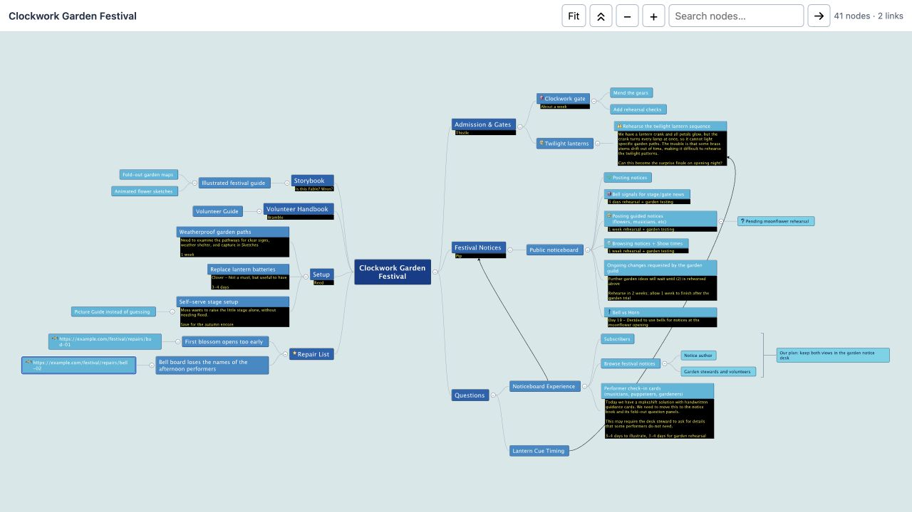

# Freeplane Interactive HTML

Experimental whole-map HTML export for **Freeplane 1.13.3**. The exporter runs inside Freeplane and adds **File > Export > Interactive HTML (*.html)**. It captures native node artwork into SVG and embeds it with map metadata in an interactive HTML viewer.

1. The viewer supports folding, expand/collapse all, search, pan, zoom, and fit. It supports both map sides, single-level summary groups, and cubic crosslinks whose native control handles are translated with their endpoints. Node artwork comes from Freeplane; browser layout and branch/summary routing are custom and do not reproduce the full native map layout.
2. Compatibility is experimental and limited to Freeplane 1.13.3. Native renderer reflection and internal APIs can change. Runtime smoke validation passed on Freeplane 1.13.3 with JDK 21.0.11 on macOS 26.2, including native export dispatch and state restoration after success and forced failure. Nested summaries, other connector shapes, broader map features, large-map performance, and other Freeplane versions require further validation. Unsupported capture cases may fail rather than produce output.
3. The runtime consists of the two Groovy files and HTML template in `src/`. Export needs the installed Freeplane application and Java 21; Java 21 is the tested configuration. Python, Node, probe launchers, and compiled test classes are developer tools only. Browser compatibility, external linked content, and direct `file://` loading have not been established as a general offline runtime guarantee.



## Install the experimental manual ZIP

1. Download the [experimental ZIP](https://github.com/shlomi-dr/freeplane-interactive-html/releases/download/v0.1.0-alpha.1/freeplane-interactive-html-manual.zip), or build it using the command below. This is a manual file-install ZIP. Installation and removal through Freeplane's add-on manager are planned for a later release.
2. In Freeplane, choose **Tools > Open user directory**. Keep that directory open, then quit Freeplane. If one of the following paths already exists, preserve it before replacing files.
3. Extract the ZIP **into that user directory**, with these relative paths:

   ```text
   scripts/init/interactive-html.groovy
   addons/interactive-html/resources/InteractiveHtmlAddon.groovy
   addons/interactive-html/resources/viewer-template.html
   addons/interactive-html/README.md
   addons/interactive-html/LICENSE
   addons/interactive-html/NOTICE
   ```

4. Restart Freeplane and approve the startup script if Freeplane prompts for permission. Open a map, then choose **File > Export > Interactive HTML (*.html)** and save to a new destination. This action exports the whole map regardless of the selected node. Test with the fictional example first. Runtime checks verified restoration of map/view state after successful and failed capture, and preservation of an existing destination after failed capture.
5. To remove this installation, quit Freeplane and remove exactly `scripts/init/interactive-html.groovy`, `addons/interactive-html/resources/InteractiveHtmlAddon.groovy`, `addons/interactive-html/resources/viewer-template.html`, `addons/interactive-html/README.md`, `addons/interactive-html/LICENSE`, and `addons/interactive-html/NOTICE` from the same user directory. Remove the now-empty `addons/interactive-html/resources` and `addons/interactive-html` directories if desired, then restart Freeplane. Keep other startup scripts and add-ons.

## Examples and development

1. `examples/Clockwork Garden Festival.mm` contains fictional festival planning content and reserved `example.com` links. `examples/Clockwork Garden Festival.html` was exported from the unmodified fixture by the current in-process engine. Browser interaction checks passed for this fresh output over local HTTP; see [validation status](docs/VALIDATION.md).
2. Build the manual ZIP with Python 3's standard library:

   ```sh
   python3 scripts/package.py
   ```

   The result is `dist/freeplane-interactive-html-manual.zip`. The build uses an explicit file allowlist, fixed ZIP timestamps and permissions, sorted entries, and stored bytes for reproducibility. It never installs files into a Freeplane profile. Python is a developer build dependency only.
3. Check Python syntax without generating compiled files:

   ```sh
   python3 -c "import ast,pathlib; ast.parse(pathlib.Path('scripts/package.py').read_text())"
   ```

   There is no configured project lint tool. The packaging script checks archive integrity and layout after writing.
4. Run the portable smoke test from a graphical desktop with an installed Freeplane distribution and JDK 21. Set `FREEPLANE_HOME` to the directory containing `freeplanelauncher.jar` and `JAVA_HOME` to the JDK directory:

   ```sh
   export FREEPLANE_HOME=/path/to/freeplane/distribution
   export JAVA_HOME=/path/to/jdk-21
   scripts/smoke-test.sh
   scripts/smoke-test.sh --demo
   ```

   Both commands compile against that installation and run Freeplane in a disposable profile. The smoke test exercises export and restoration; `--demo` exports the unmodified example to `baseline.html` in the reported artifact directory. Logs and artifacts remain there for inspection. The profile automatically approves known test scripts using `execute_scripts_without_asking=true`; this is limited to the disposable test profile. The launcher's security-manager bootstrap setting is test-only: Freeplane installs its own manager. Neither setting is an installation instruction or a requirement for exporting from an ordinary profile. Keep normal file/network restrictions. See [validation status](docs/VALIDATION.md) for coverage and limitations.
5. Next packaging milestone: a native Freeplane `.mm` add-on installer with managed removal. Broader map and platform coverage is tracked separately from the working manual installation.
6. Authored project content is licensed under **GPL-2.0-only**. See [LICENSE](LICENSE) and [NOTICE](NOTICE). Freeplane and Batik are supplied by the installed application and are not bundled here.
